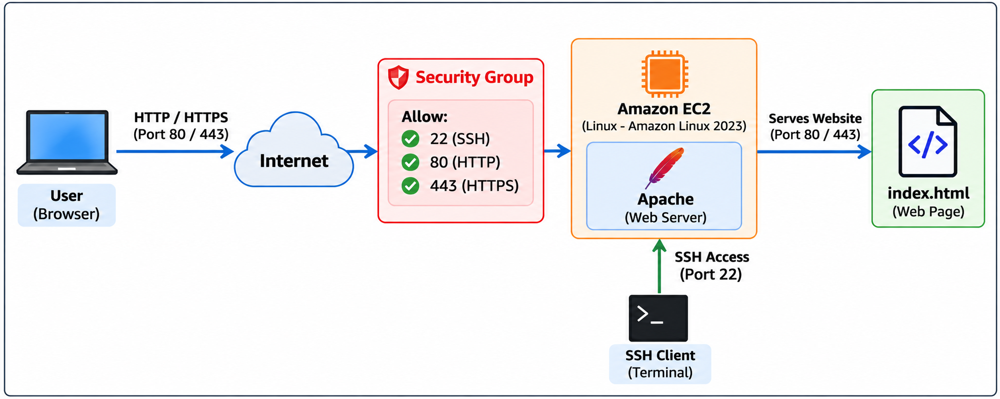
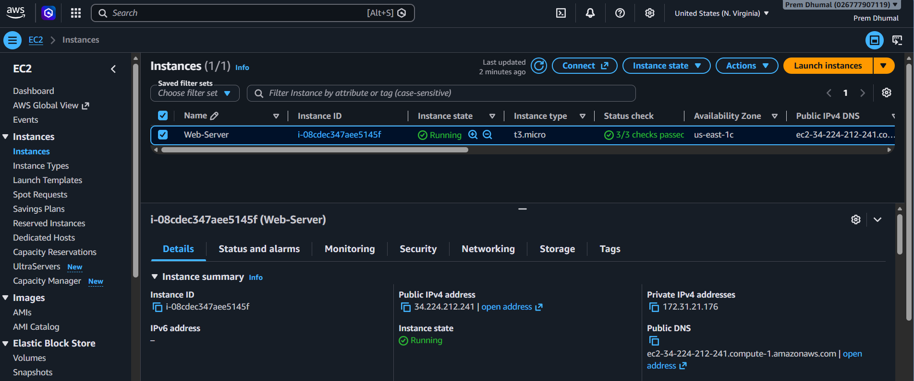
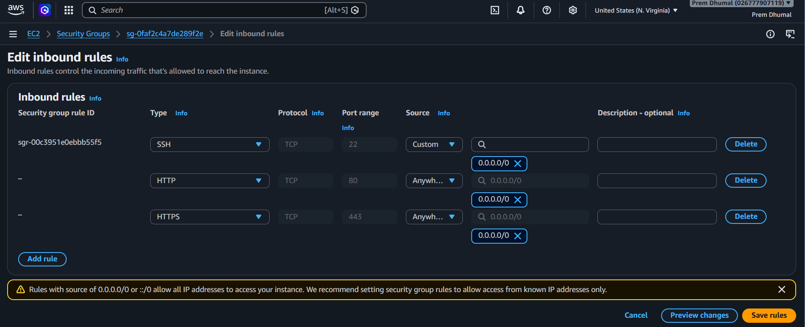
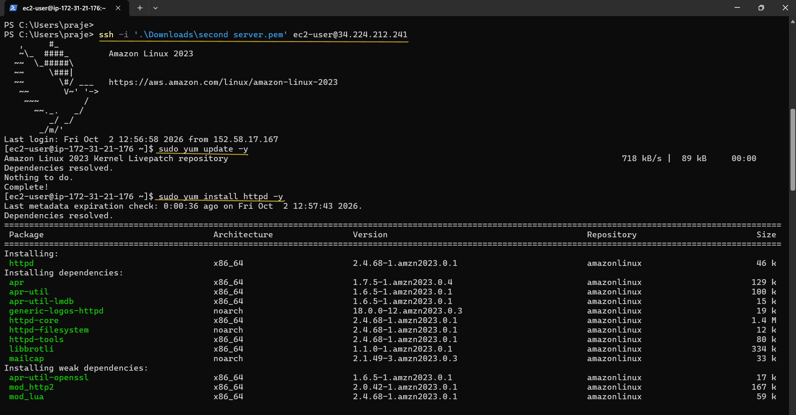
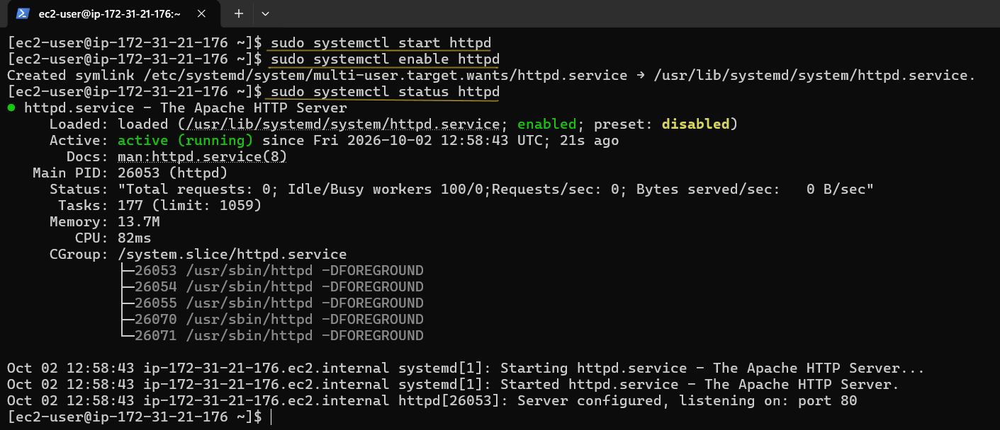
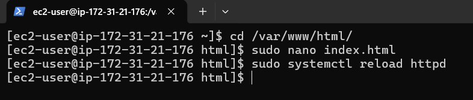
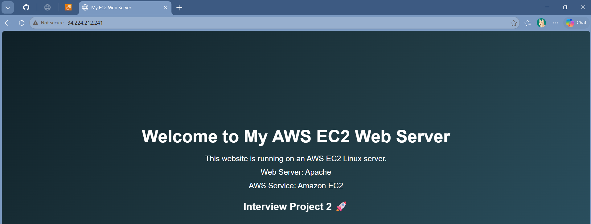

# AWS EC2 Linux Web Server

A simple AWS EC2 Linux web server project using Apache and Security Groups.

## Project Overview

In this project, I launched a Linux EC2 instance on AWS and configured it as a web server.

I configured a Security Group, installed Apache on Amazon Linux 2023, created a simple `index.html` webpage, and accessed the website using the EC2 public IP address.

## Technologies Used

- Amazon EC2
- Amazon Linux 2023
- Security Group
- Apache Web Server
- HTML

## Architecture Diagram



## Steps Performed

### 1. EC2 Instance

Launched and checked the Linux EC2 instance.



### 2. Security Group

Configured the Security Group with the required inbound ports.



### 3. Install Apache

Installed the Apache web server on the EC2 Linux server.



### 4. Start Apache Service

Started Apache and checked that the web server service was running.



### 5. Create index.html

Created the `index.html` webpage inside the Apache web root and reloaded the Apache service.



### 6. Final Website

Opened the website using the EC2 public IP address.



## Security Group Ports

| Port | Protocol | Purpose |
|---|---|---|
| 22 | TCP | SSH – used to remotely connect to the EC2 instance |
| 80 | TCP | HTTP – used to access the website |
| 443 | TCP | HTTPS – used for secure website access |

## What I Learned

Through this project, I got hands-on experience with:

- Launching and checking a Linux EC2 instance.
- Configuring Security Group inbound rules.
- Understanding the use of ports 22, 80, and 443.
- Installing and managing the Apache web server.
- Creating and deploying a simple HTML webpage.
- Using the EC2 public IP to access a website.
- Understanding how an EC2 Linux instance can work as a web server.

## Project Structure

```text
aws-ec2-linux-web-server/
│
├── README.md
├── architecture-diagram.png
│
└── screenshots/
    ├── 01_EC2_Instance_Details.png
    ├── 02_Security_Group_Inbound_Rules.png
    ├── 03_Install_Apache.png
    ├── 04_Start_Apache_Service.png
    ├── 05_Create_Index_HTML.png
    └── 06_Final_Website_Output.png
```
